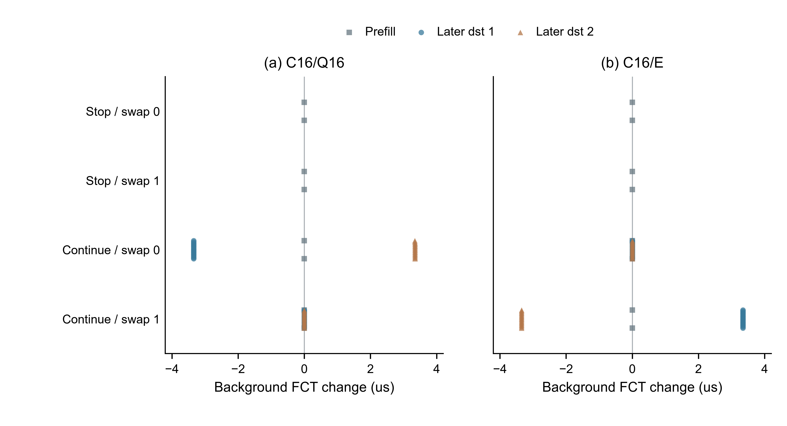

# WS-30 阶段 3 队列组成节点报告

记录日期：2026 年 10 月 25 日。冻结的 12 格正式组成矩阵全部成功，失败 0 格，待运行 0 格。逐格复核固定源码、输入、252 条原始 FCT、队列入出事件和探针路径，均通过。

本节点识别出类别加权的规则响应：两出口总队列相同，交换背景组成后，C16 随之改变首包出口；Q16 保持总队列平局时的首候选。然而，4 种受控条件内三臂的完整标签 2 批时间、探针自身 FCT 和背景 P99 均相同。持续背景条件还出现背景 QP 之间的时延转移，不能据汇总指标不变声称所有流均无代价。

## 1. 冻结输入与执行证据

仿真固定为 `2d7e31a9f6ae24f1514d02cbf341d27e6ec0717f`，分支为 `research/ws30-attribution-audit`，启动控制代码 HEAD 为 `eda78d7d5ac749fbbfeb18df79591af964d7545b`。冻结计划 SHA-256 为 `77ca6064d4b4f275b409123302b01bd4eabd97e9c978e013f8d3e67edbf420f8`。四份 trace、拓扑、授权和逐格原始文件哈希见[原始审计索引](evidence/ws30-stage3-composition-raw-audit-r1.json)与[分析溯源](evidence/ws30-stage3-composition-analysis-provenance-r1.json)。

矩阵为 2 种组成方向 × 2 种后续到达条件 × E/Q16/C16，共 12 格。各算法在同一条件下复用同一输入；每个条件每臂只有 1 次仿真，4 种条件是控制干预，不是独立需求重复。本报告使用逐条件配对差和逐流记录，不计算总体置信区间或显著性。

| 预设验收项 | 实际证据与结果 |
| --- | --- |
| 正式格执行与隔离 | 12 个独立 ID，12 次唯一启动；远端终态全部 `SUCCEEDED`，本地全部回传并复核；成功格未重跑 |
| 真实队列与组成 | 每出口 64 个真实数据包、65,536 B；探针前总队列相同，背景字节按方向交换；逐事件守恒、终态排空 |
| 选择规则 | 12 格逐一核对探针首包和后续 15 包；出口符合 E/Q16/C16 规则，QP 内路径未变 |
| 两侧原始指标 | 252 条完成记录与输入 QP 一一对应，身份、类别、字节和时间重新构建；完整批次、探针和背景分别统计 |
| 重要节点借鉴复核 | DiffFlow v1、SeqBalance v1、LetFlow 官方版的技术分析、核验记录和 PDF 哈希已复核 |

控制器 PID 为 7896，2026 年 10 月 25 日 14:23:16 启动，14:46:04 完成最后一批验收。实际运行上下文为 GPT-6 Luna / Medium，实际分析上下文为 GPT-6.1 Sol / Medium，均由会话 JSON 的 `turn_context` 核实。12 格均使用 cap=4。合并运行器窗口和逐格资源收据，已记录的最高 load1 为 7.46，最低可用内存为 122.469 GiB，最低空闲磁盘为 3,063.864 GiB。终态快照没有其他 UID 作业或未知仿真进程。

每格资源监视器仅记录 2 个样本，进程树 RSS 样本均为 0 MiB；短仿真可落在采样间隔内，故这些值不能给出实际 RSS 峰值。前一条快速进度汇报引用了第二个窗口的 load1=5.96 和磁盘值，本报告采用全部收据的范围。详见[执行审计](evidence/ws30-stage3-composition-execution-audit-r1.json)。

## 2. 首包前的真实状态与选择

输入由 4 个预填 QP 和 1 个探针 QP 组成。每个预填 QP 发送 31,232 B 载荷，形成 31 个 1,048 B 线上包和 1 个 280 B 尾包；每出口有 2 个预填 QP，合计 64 包、65,536 B。两类包共享同一优先级队列，夹具通过同时暂停两个出口建立相等积压，没有直接覆写队列或评分。组成交换改变预填 QP 的类别标签，保持载荷、发送时刻和拓扑。

| 事件 | 实测时刻（ns） |
| --- | ---: |
| 完整标签 2 批次原点 | 2,000,000,000 |
| 最后预填包入队 | 2,000,003,500 |
| 探针自身释放 | 2,000,020,000 |
| 探针首包到达交换机 4 | 2,000,021,020 |
| 探针第 16 包入队 | 2,000,021,320 |
| 两出口解除暂停并开始出队 | 2,000,022,000 |
| 持续条件的首个后续背景包入队 | 2,000,023,019 |

探针到达时，两个出口仍暂停，队列均为 65,536 B。方向 0 的背景字节为端口 2 上 65,536 B、端口 3 上 0 B；方向 1 相反。Q16 只按总队列比较，首候选为端口 2、次候选为端口 3，平局保留端口 2。C16 的 MoE 评分为总队列字节加背景队列字节，因此两方向的评分分别为 `(131072, 65536)` 和 `(65536, 131072)`。E 的 ECMP 探针出口为端口 3。

| 组成方向 | 后续背景 | 两端总队列（B） | 两端背景队列（B） | E | Q16 | C16 |
| --- | --- | --- | --- | ---: | ---: | ---: |
| 0 | 停止预填 | 65,536 / 65,536 | 65,536 / 0 | 3 | 2 | 3 |
| 1 | 停止预填 | 65,536 / 65,536 | 0 / 65,536 | 3 | 2 | 2 |
| 0 | 持续到达 | 65,536 / 65,536 | 65,536 / 0 | 3 | 2 | 3 |
| 1 | 持续到达 | 65,536 / 65,536 | 0 / 65,536 | 3 | 2 | 2 |

图 1：12 格的实际首包出口。每格显示 1 次固定探针决策，无重复抽样或误差条；其余 15 个探针数据包均沿用相同出口。两方向中 C16 均选择没有预填背景字节的一侧，与 Q16 的差异在方向 0 可直接识别。该规则响应与业务时间效果分别由日志和 FCT 验证。

## 3. 完整批次、探针与背景指标

标签 2 含 2 个预填 MoE QP 和 1 个探针 QP。完整批次时间为所有标签 2 QP 的最晚完成时刻减去 2,000,000,000 ns；探针自身 FCT 从 2,000,020,000 ns 起算。探针绝对完成时刻为 2,000,045,665 ns，因而完整批次为 45.665 μs，探针自身为 25.665 μs。两者不能互换，标签 2 单流最大 FCT 也不能代替完整批次时间。

背景 P99 使用全部标签 1 QP 的 FCT，以排序下标 `(n−1)×0.99` 线性插值。停止预填条件有 2 个背景 QP；持续条件有 34 个，其中 32 个后续 QP 从 2.000022 s 起每 1 μs 各向两个目的地释放 1 个，每个 8,000 B。持续条件的背景载荷从 62,464 B 增至 318,464 B，背景完整批时间包含后续到达区间。

| 方向 | 后续背景 | 臂 | 标签 2 批时间（μs） | 探针 FCT（μs） | 背景 P99（μs） | 背景批时间（μs） |
| --- | --- | --- | ---: | ---: | ---: | ---: |
| 0 | 停止预填 | E | 45.665 | 25.665 | 40.08545 | 40.086 |
| 0 | 停止预填 | Q16 | 45.665 | 25.665 | 40.08545 | 40.086 |
| 0 | 停止预填 | C16 | 45.665 | 25.665 | 40.08545 | 40.086 |
| 1 | 停止预填 | E | 45.665 | 25.665 | 40.08645 | 40.087 |
| 1 | 停止预填 | Q16 | 45.665 | 25.665 | 40.08645 | 40.087 |
| 1 | 停止预填 | C16 | 45.665 | 25.665 | 40.08645 | 40.087 |
| 0 | 持续到达 | E | 45.665 | 25.665 | 40.06785 | 70.197 |
| 0 | 持续到达 | Q16 | 45.665 | 25.665 | 40.06785 | 70.197 |
| 0 | 持续到达 | C16 | 45.665 | 25.665 | 40.06785 | 70.197 |
| 1 | 持续到达 | E | 45.665 | 25.665 | 40.06885 | 70.197 |
| 1 | 持续到达 | Q16 | 45.665 | 25.665 | 40.06885 | 70.197 |
| 1 | 持续到达 | C16 | 45.665 | 25.665 | 40.06885 | 70.197 |

每种条件内 Q16/E、C16/E、C16/Q16 的上述指标差均为 0；背景均值、P50、P95 和最大 FCT 也相同。跨方向背景 P99 的 1 ns 差异来自被交换标签的预填 QP 完成次序。持续条件的 P99 比停止条件略低，源于样本数从 2 变为 34 后的插值位置改变；它不表示同一背景流变快。完整数值见[逐格指标 CSV](evidence/ws30-stage3-composition-metrics-r1.csv)。

停止预填条件的全部 5 条 FCT 在三臂间逐字节相同。持续条件中，探针整列 16 包在解除暂停前已进入所选出口，后续背景包在它们之后入队；两个候选出口的初始 FIFO 工作量、速率与释放时刻相同。类别标签没有改变这些包的服务顺序，因此首包选路响应未转化为本夹具的探针或完整批次改善。这一解释由队列事件顺序支持，适用范围是本次共同暂停、对称链路和固定 QP 输入。

原始 FCT 中，持续条件每格有 14 条实际起始时刻比十进制 trace 时刻早 1 ns，其余 23 条相同；审计保留计划与实际时刻，使用实际起始时刻加 FCT 重建完成时间。预填与探针原点均精确一致，未沿用先占矩阵的标签 2 原点。

## 4. 汇总相同仍有局部背景代价

持续背景中，两条预填背景 QP 保持不变，决定了最大的两个背景 FCT。32 条后续 QP 的 FCT 均小于这两条，故本次 P99 不呈现它们之间的时延转移。

| 持续条件对照 | 背景变快 / 相同 / 变慢 | 逐流变化范围（ns） |
| --- | ---: | ---: |
| 方向 0，C16/Q16 | 16 / 2 / 16 | −3,344 ～ +3,345 |
| 方向 0，C16/E | 0 / 34 / 0 | 0 |
| 方向 1，C16/Q16 | 0 / 34 / 0 | 0 |
| 方向 1，C16/E | 16 / 2 / 16 | −3,345 ～ +3,344 |

方向 0 的 C16/Q16 中，目的地 1 的后续背景 QP 变快，目的地 2 的变慢。最不利 QP `[0,2,10006,102,8000]` 的 FCT 从 19.774 μs 增至 23.119 μs，增加 3.345 μs（16.916%）。方向 1 的 C16/E 中，目的地 1 的后续 QP 变慢；`[0,1,10005,102,8000]` 从 19.774 μs 增至 23.118 μs，增加 3.344 μs（16.911%）。Q16/E 在两个持续方向中也各有 16 条变快、16 条变慢；全部配对见[逐流差值 CSV](evidence/ws30-stage3-composition-flow-contrasts-r1.csv)。

图 2：每个点对应 1 条配对背景 QP，横轴为候选减对照的 FCT，正值表示变慢。停止条件每行每对照 2 条，持续条件每行每对照 34 条，两个面板均保留全部背景 QP；纵向展开仅为显示重叠点。没有独立重复、重采样区间或显著性标记。背景均值和 P99 不变与局部代价同时成立。

本节点全部格的队列丢弃、准入拒绝、重传、超时和接收 gap 计数为 0。停止条件的 CNP 为 0；持续条件每格探针 QP 收到 1 次 CNP，三臂计数相同。逐流时延变化与探针转移出口后两组背景的排队代价转移一致；这些计数和本次固定输入不足以预测更大工作负载下的传输代价。

## 5. 参考借鉴复核与结论边界

本次从候选 README 和累计阅读记录进入，复核以下固定版本的相关技术分析、核验记录和 PDF 哈希，记录于[参考复核收据](evidence/ws30-stage3-composition-reference-review-r1.json)。

| 固定版本 | 本节点借鉴点与条件 | 与当前机制的区别及不能外推的结论 |
| --- | --- | --- |
| DiffFlow，arXiv:1604.05107v1 | 固定共同队列与服务条件，再判断分类和选路的影响 | 原文使用长流识别、盲喷洒、Java 简化传输与分类独立队列；本节点是实际共享 FIFO 上的首次 QP 选择。作者的归一化平均 FCT 不能支持本项目批次或 P99 收益 |
| SeqBalance，arXiv:2407.09808v1 | 以最晚完成时刻与完整任务原点聚合，同时核对 QP 路径和传输代价 | 本节点没有 WQE 拆分、子 QP 或父 CQE；只借鉴完成语义的审计方法。正式期刊全文尚未与固定预印本比较，论文数字不能作为本项目效果证据 |
| LetFlow，NSDI 2017 USENIX 官方 PDF | 解释时延前先核对是否存在实际适应机会，区分分配改变和业务完成 | LetFlow 依赖随机 flowlet 重选与单元大小弹性；本节点探针固定 QP 路径、相等积压与共同释放，没有对应适应过程。其 TCP、OMNeT++ 或硬件结果不能外推到本夹具 |

本节点完成了冻结的组成验收与效果分析：C16 的类别队列权重确实参与首包选择，但本次四种受控条件没有得到完整批次、探针 FCT 或背景 P99 的改善；持续背景揭示了局部 QP 代价转移。这个结果支持规则响应的可识别性，也限定了由它推断性能的范围。没有据此追加权重、提前量或输入搜索。

WS-30 仍为 ACTIVE。组成节点交主对话验收后，尚须完成主矩阵、先占与组成的跨阶段最终图表及综合结论；本报告不替代该项整体验收。

## 6. 复算与交付索引

- [正式结果索引](evidence/ws30-stage3-composition-results-r5.json)：12 格运行器原始验收结果。
- [独立原始审计](evidence/ws30-stage3-composition-raw-audit-r1.json)：每格 QP、字节、原点、队列与文件 SHA-256。
- [完整分析](evidence/ws30-stage3-composition-analysis-r1.json)：4 种条件、三组配对和全部逐格指标。
- [全部逐流记录](evidence/ws30-stage3-composition-flows-r1.csv)：252 行，保留计划与实际起始时刻。
- [执行审计](evidence/ws30-stage3-composition-execution-audit-r1.json)、[分析溯源](evidence/ws30-stage3-composition-analysis-provenance-r1.json)、[图表 QA](figures/ws30-stage3-composition-r1/qa.json)。

分析命令为 `python scripts/analyze_ws30_stage3_composition.py`，绘图命令为 `python scripts/plot_ws30_stage3_composition.py`。分析只读取既有正式 raw，绘图读取分析文件；分析 JSON 采用冻结写入，内容发生变化时拒绝覆盖。
