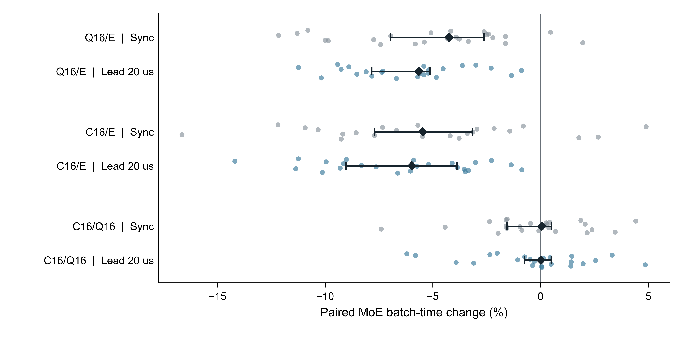
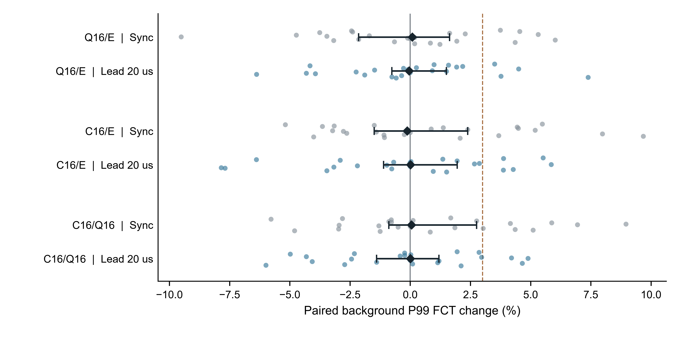
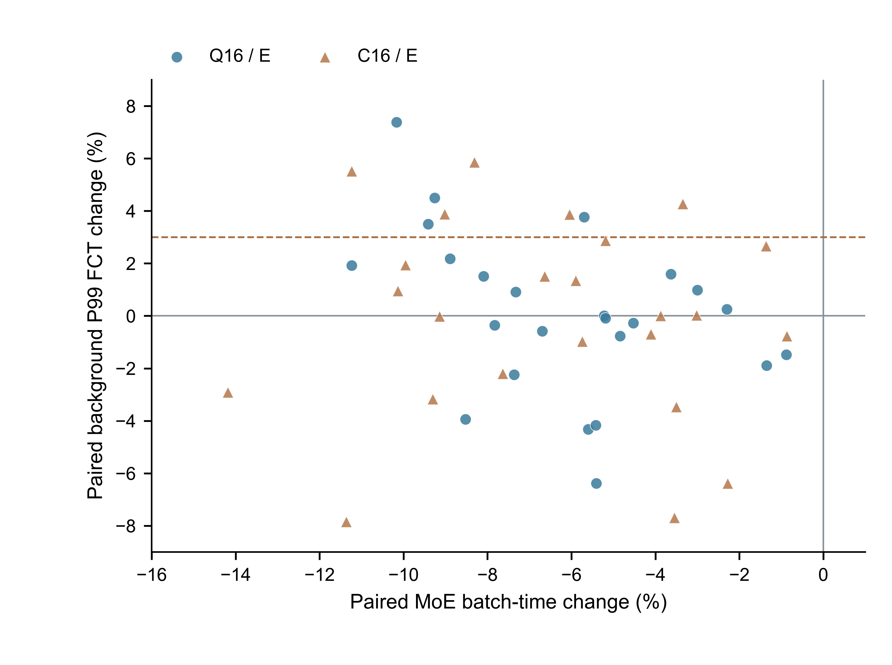

# WS-30 阶段 3 背景先占矩阵节点报告

日期：2026 年 10 月 25 日。范围：72 格正式先占矩阵、72 格同步对照复核、同需求双侧分析和参考借鉴复核。先占矩阵已完成，等待主对话核对。WS-30 仍为 ACTIVE，正式组成实验尚未启动。

背景提前 20 µs 后，Q16 和 C16 的 MoE 批时间在 24/24 个需求上都低于 E。不过，C16 相对 Q16 的类别加权增量仍接近零，区间跨零。背景 P99 的中位代价较小，但部分需求仍出现超过 +3% 的劣化。该节点完成了预设时序条件的验证，尚未形成普遍的类别收益结论。

## 数据与原始证据

先占矩阵包含同一批 24 个需求 seed（`20263021`～`20263044`），每个需求覆盖 E、Q16 和 C16，共 72 个原始实验 ID。ID 格式为 `20261024-230000-ws30-lead-s<seed>-<arm>`。固定仿真源码 SHA 为 `1ef424749e3c551dd788d0a709bd8e21c7cc89c9`。冻结计划 SHA-256 为 `77ca6064d4b4f275b409123302b01bd4eabd97e9c978e013f8d3e67edbf420f8`。

每格有 16,384 条 8 KiB MoE QP 和 192 条 8 MiB 背景 QP。72 格共完成 1,193,472 条流，完成身份和字节数与输入一一对应。远端元数据为 72/72 `SUCCEEDED`，本地 `verify-local --phase lead` 为 72/72，失败 0，pending 0。控制器已退出；72 个启动事件对应 72 个唯一 ID，成功格没有重跑。终态远端查询也确认 12 个正式组成 ID 尚无元数据。见[实验结果索引](evidence/ws30-stage3-lead-results-r5.json)和[执行审计](evidence/ws30-stage3-lead-execution-audit-r1.json)。

本节点另对同步主矩阵的同 24 个需求、同三臂复核了 72 格。共 144 格均重新运行既有验收器，并用独立代码重建端口身份、精确时间和 FCT 指标。原始文件、配置、元数据和日志的 SHA-256 均保留在[逐格原始审计](evidence/ws30-stage3-lead-raw-audit-r1.json)。同 seed 的六格具有相同流身份、大小和标签；条件只改变 MoE 释放时刻。没有排除需求、流或不利结果。

公共设置为既定拓扑、400 Gbps、DCQCN、PFC=0、IRN=1、9 MiB buffer、ns-3 seed 1。配置中的 E、Q16、C16 模式分别核对为 0、27、21。显式 trace 已固定，`netload=10` 不解释为实测链路负载。

## 时间原点与统计单位

背景从 `2.000000000 s` 释放，MoE 从 `2.000020000 s` 释放。独立解析用十进制定点换算得到 MoE 原点 `2,000,020,000 ns`。72 格的 MoE 批时间均计算为 `max(start_ns + fct_ns) − t0_MoE`。背景 P99 用全部 192 条背景流各自的 FCT，采用线性插值分位数。以全 trace 最早时刻作为 MoE 原点会额外计入 20 µs，本节点没有使用该口径。

独立单位为 24 个需求 seed。同步与先占是同需求内的相关条件，各臂也是配对观测。每个 seed 先计算 `100 × (候选值 / 参照值 − 1)`，再取 24 个变化的中位数。百分比为负表示完成时间更低。

区间按需求层 bootstrap 10,000 次计算，固定随机 seed 为 `20263003`。本节点为所有对比共用同一份重采样索引，保留条件内相关结构。表中均为名义双侧 95% 描述区间，不附显著性标签。同步结果的配对中位数与既有主矩阵完全一致。统一重采样后，个别区间端点略有变化；原主矩阵分析文件保留原样，逐项差异记在分析 JSON 的 `synchronous_regression`。

## 两侧配对结果

括号内为名义 95% 区间。背景 +3% 是预设工程线，约束候选/E 的配对中位数，同时报告逐输入越线数；它不是统计非劣效检验。

| 条件 | 对比 | MoE 批时间变化 | 背景 P99 变化 | 背景超过 +3% 的需求 |
| --- | --- | --- | --- | --- |
| 同步 | Q16/E | −4.242%（−6.956%～−2.618%） | +0.089%（−2.144%～+1.636%） | 5/24 |
| 同步 | C16/E | −5.461%（−7.701%～−3.152%） | −0.123%（−1.497%～+2.386%） | 7/24 |
| 同步 | C16/Q16 | +0.058%（−1.561%～+0.499%） | +0.059%（−0.891%～+2.759%） | 不适用 |
| 先占 20 µs | Q16/E | −5.648%（−7.828%～−5.123%） | −0.044%（−0.763%～+1.505%） | 4/24 |
| 先占 20 µs | C16/E | −5.970%（−9.021%～−3.872%） | +0.014%（−1.105%～+1.949%） | 5/24 |
| 先占 20 µs | C16/Q16 | +0.020%（−0.740%～+0.492%） | +0.012%（−1.394%～+1.196%） | 不适用 |

先占条件下，Q16/E 和 C16/E 的 MoE 配对变化均为 24 个负值。前者范围为 −11.235%～−0.881%，后者为 −14.187%～−0.868%。两臂的背景变化中位数都低于 +3% 工程线，但不代表每个需求都受益。

C16/Q16 的 MoE 变化有 11 个负值、12 个正值和 1 个零值，范围为 −6.206%～+4.863%。背景变化有 11 个负值、12 个正值和 1 个零值，范围为 −5.992%～+4.893%。该分布没有识别出清晰的类别加权增量，也不是等效性证明。

图 1：每个小点是一份需求的配对变化，每行保留全部 24 个点。黑色菱形为中位数，横线为需求层 bootstrap 名义 95% 区间。同步与先占共享需求，不能合并为 48 个独立样本。

图 2：点、中心和区间定义同图 1。虚线为 +3% 工程参考线，其预设适用对象是 Q16/E 和 C16/E，C16/Q16 不据此判门槛。完整数据见[逐格指标 CSV](evidence/ws30-stage3-lead-paired-r1.csv)和[逐需求对比 CSV](evidence/ws30-stage3-lead-contrasts-r1.csv)。

## 条件变化、分布与反例

比较条件差异时，先在同一个 seed 内计算对数比差：`100 × log[(候选/参照)先占 / (候选/参照)同步]`。这是描述性交互量，负值表示先占条件中的相对完成时间比更低。不能用一个条件的区间跨零、另一个不跨零来代替条件比较。

| 对比 | MoE 对数比差 ×100 | 背景 P99 对数比差 ×100 |
| --- | --- | --- |
| Q16/E | −0.489（−3.237～+1.210） | −0.399（−2.001～+1.315） |
| C16/E | −0.309（−3.070～+1.087） | −0.276（−1.484～+0.568） |
| C16/Q16 | −0.434（−1.304～+1.018） | +0.128（−2.972～+0.670） |

上述条件差异的区间均跨零。先占条件的 Q16/E、C16/E 中位降幅较大，但同需求比较尚未显示清晰的条件增量。分析 JSON 同时保存对数比差、百分比效应之差和比值之比，三种量分别命名。

| 条件与臂 | 跨需求 MoE 批时间中位数 | 跨需求 MoE 批时间 P95 | 跨需求背景 P99 中位数 |
| --- | ---: | ---: | ---: |
| 同步 E | 18.502 µs | 19.539 µs | 1,718.784 µs |
| 同步 Q16 | 17.298 µs | 18.572 µs | 1,714.307 µs |
| 同步 C16 | 17.191 µs | 19.152 µs | 1,700.731 µs |
| 先占 E | 18.083 µs | 19.510 µs | 1,795.696 µs |
| 先占 Q16 | 17.192 µs | 18.014 µs | 1,769.432 µs |
| 先占 C16 | 16.950 µs | 17.857 µs | 1,735.036 µs |

此表是跨需求绝对值分布，不用“中位数之比”替代前表的“逐需求比值中位数”。两类逐流 P50/P95/P99、最大 FCT、批尾身份及跨需求分位数均保存在[分析 JSON](evidence/ws30-stage3-lead-analysis-r1.json)与逐格 CSV 中。先占 C16/Q16 的 MoE 批尾身份在 20/24 个需求上改变；这说明尾流会切换，不能仅按固定某条 QP 推断批次代价。

先占 Q16/E 的背景越线需求为 `20263022、20263024、20263036、20263044`；最差为 `20263022` 的 +7.387%。C16/E 的越线需求为 `20263024、20263025、20263033、20263043、20263044`；最差为 `20263033` 的 +5.854%。

类别增量的反例为 seed `20263025`：C16 的 MoE 批时间为 16.991 µs，Q16 为 16.203 µs，相对变慢 4.863%；背景 P99 同时变慢 4.652%。在 seed `20263043`，C16 的 MoE 批时间为 16.732 µs，Q16 为 17.839 µs，降低 6.206%；背景 P99 则增加 2.859%。两种方向均完整保留。对应原 ID 使用上述 seed 和 `-c16`、`-q16` 后缀，可从审计表直接定位。

图 3：每种标记保留 24 个需求，分别表示 Q16/E、C16/E。横轴为 MoE 批时间变化，纵轴为同一需求的背景 P99 变化。虚线为背景 +3% 工程参考线。每个需求的坐标、ID 和原始值均在 CSV 中。

## 首包队列组成与传输代价

计数来自固定源码的 `Ws30Choice`。`events` 包含候选端口相同的情况；组成统计仅在候选端口不同时计算。因此下表比例分母为 `events − same`。这些是观测事件的描述比例，不作为独立统计样本。

| 条件与臂 | MoE 不同候选事件 | 候选含非零背景比例 | 两种评分选择分歧率 | 近等总队列且异组成比例 |
| --- | ---: | ---: | ---: | ---: |
| 同步 Q16 | 613,068 | 33.549% | 4.000% | 16.255% |
| 同步 C16 | 613,041 | 32.392% | 4.727% | 17.097% |
| 先占 Q16 | 613,042 | 26.778% | 3.265% | 13.776% |
| 先占 C16 | 612,943 | 25.970% | 3.851% | 14.497% |

20 µs 提前量没有提高这两臂首包候选含背景比例或评分分歧率。因此，不能把这一条件称为“更强的类别组成暴露”。它改变了业务相对到达时序；整网状态和传输随之共同变化。观测时刻的评分分歧也不是两个完整网络执行的反事实效应。

72 格先占结果中，E、Q16、C16 的路径变化 QP、端口变化、接收序号空洞、重复到达、SACK、重传包、重传字节和 timeout 计数均为 0。队列记账违规、排队丢弃、准入丢弃、拒收和终态占用均为 0。三臂累计 CNP 反馈分别为 64,592、62,209、63,522；它们是拥塞反馈计数，不作为丢包或乱序量。所有计数与单格原始日志的哈希一并保留。

## 执行、资源与安全恢复

实际仿真开始于北京时间 2026 年 10 月 25 日 09:16:07，最后一格结束于 12:41:49，最终验收在 12:42:08 完成。首批 12 格使用 cap=12，其余 60 格使用 cap=4。峰值 load1 为 12.10，最低可用内存为 69.616 GiB，最低空闲磁盘为 3,083.973 GiB，最高 worker 树 RSS 为 4545.035 MiB，均满足既定资源门槛。

北京时间 09:22:23，控制器记录未知模拟 PID `265907`：UID 1000，PPID `265859`，进程名 `network-load-ba`，命令行仅保留为 `[network-load-ba]`，记录启动时间为 UTC 01:16:22。该快照未匹配到 worker。控制器立即停止新格准入，排空并验收首批 12 个成功格后退出。后续新鲜快照中该进程已消失。其进一步归属无法从留存信息重建，不能认定为其他用户作业或某个已知 worker。

恢复前重新核验了 12 个成功格、剩余路径状态、锁与资源，实际模型为 Luna / Medium。恢复沿用 cap=4，并从原始收据继续。终态全计划查询没有活动未知仿真或其他 UID 作业。分析回合已从实际 `turn_context` 核实为 GPT-6.1 Sol / Medium，见执行审计中的分析上下文。源码、冻结输入和成功 ID 均保留。

## 本节点参考借鉴复核

本节点先读取论文项目根目录的 `参考文献/候选/README.md` 和 `reading-log.md`，随后核对下列技术分析、核验记录及本地固定 PDF 哈希。借鉴点用于解释和审查本矩阵，本次没有新增机制或实验范围。

| 固定版本 | 具体借鉴与适用条件 | 与 WS-30 的区别和不可外推内容 |
| --- | --- | --- |
| DiffFlow，arXiv:1604.05107v1，6 页；PDF SHA `f552fcb75a0cec582286db0032c81660ff161fe475609ae5e79ad7075a0ae164` | 分别检查类别来源、分路规则和各类代价，保留共同队列条件与同输入组件对照 | 论文抽样识别长流后喷洒，Java 模型省略 TCP，并用类别独立队列；本项目保留 RDMA QP、共享队列和类别标签。作者平均 FCT 结果不能支持项目双主指标，会议最终正文未比对 |
| SeqBalance，arXiv:2407.09808v1，12 页；PDF SHA `097821eb41ca8687fc829cb31fdd54e897164de0956b30a830fdbee2c14fb913` | 区分 QP 内路径固定和父请求最大完成时间；以实际接收与恢复记录核验代价 | 它拆分 WQE 为不同子 QP，并用路径反馈；WS-30 保持原 QP，未实现主机拆分。正式期刊元数据已核验，最终正文未比对；论文性能不能替代本节点 raw |
| LetFlow，NSDI 2017 官方 PDF，15 页（含封面）；PDF SHA `8a89af468f606199146c2146da6fa7e71f466504ff3543db7c7bc9359a5e8264ff` | 用传输时序和可用切换边界检查选路解释；要求区分背景提前、路径拥塞和反馈适应 | LetFlow 在 flowlet 边界随机重选，并依赖传输速率与间隔变化；本节点三臂保持 QP 路径，20 µs 仅为业务释放偏移。其 TCP、测试床和 OMNeT++ 结果不证明本项目 RDMA 或硬件收益 |

复核记录及文件哈希见[参考借鉴收据](evidence/ws30-stage3-lead-reference-review-r1.json)。原文依据分别见 [DiffFlow 技术分析](../../../../参考文献/候选/papers/diffflow-2016/analysis-technical.md)与[核验记录](../../../../参考文献/候选/papers/diffflow-2016/verification.md)、[SeqBalance 技术分析](../../../../参考文献/候选/papers/seqbalance-2024/analysis-technical.md)与[核验记录](../../../../参考文献/候选/papers/seqbalance-2024/verification.md)、[LetFlow 技术分析](../../../../参考文献/候选/papers/letflow-2017/analysis-technical.md)与[核验记录](../../../../参考文献/候选/papers/letflow-2017/verification.md)。

## 交付与剩余任务

复算入口为 `python scripts/analyze_ws30_stage3_lead.py`，绘图入口为 `python scripts/plot_ws30_stage3_lead.py`。分析记录 Python、NumPy、Matplotlib 版本和代码哈希。三张图保留全部需求点，导出 PDF、SVG 和 600 dpi PNG。PDF 最小字体为 8 pt，三份碰撞审计均无 FAIL/WARN；单轴图的多面板对齐项为不适用。静态检查仅提示未导出 TIFF，本节点交付向量图和内部报告预览，没有期刊投稿格式声明。见[图表与统计核对记录](figures/ws30-stage3-lead-r1/qa-notes.md)。

本节点结论适用于固定 ns-3 合成分布、拓扑、seed 和 20 µs 释放偏移。它不覆盖真实 MoE 训练步、真实 RNIC、交换机线速资源、其他提前量或生产硬件效果。C16/Q16 仍未显示清晰增量；后续组成实验用于验证受控队列组成与规则响应，不能自动替代本正式矩阵的业务结论。

下一步先由主对话核对本报告、144 格审计和图表数据，再安排冻结的 12 格正式组成矩阵。其后还须完成跨阶段图表和最终结论核验。上述两项仍是必做任务，WS-30 不按闭环归档。
