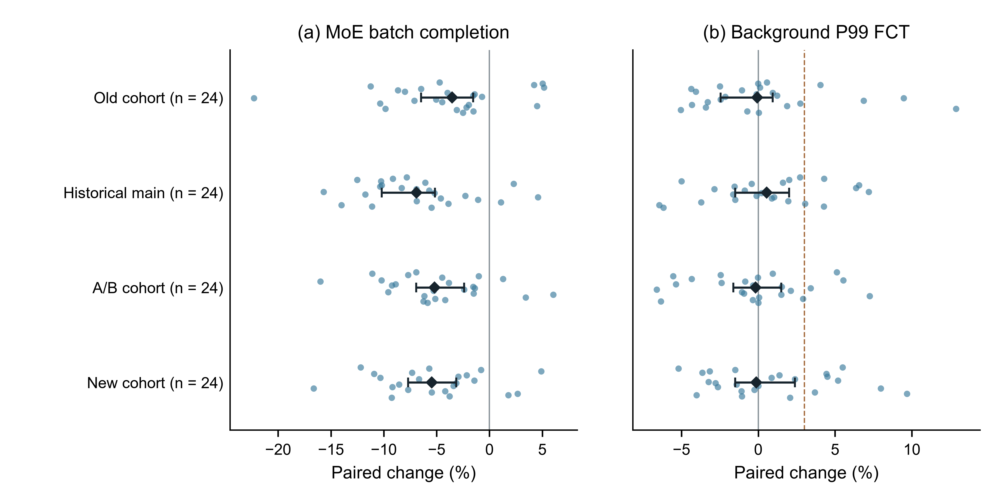
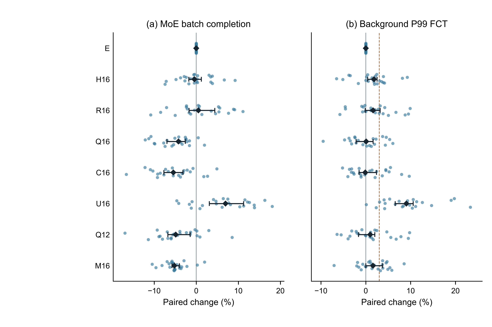
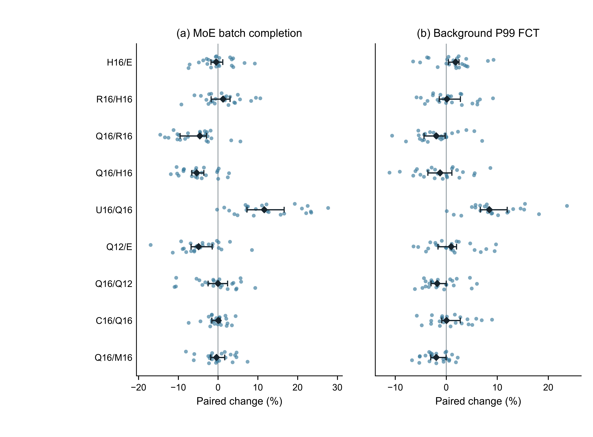
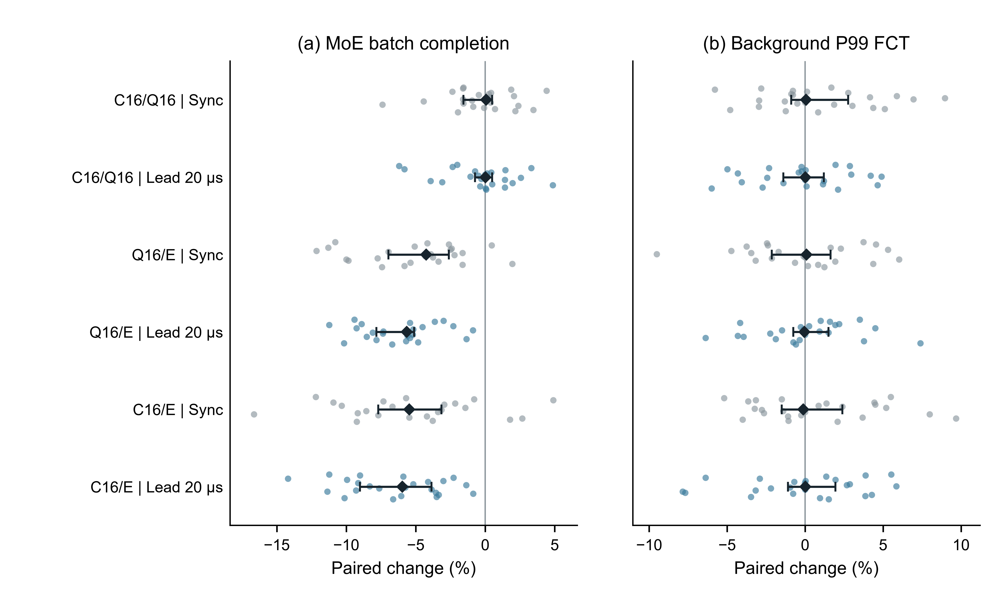
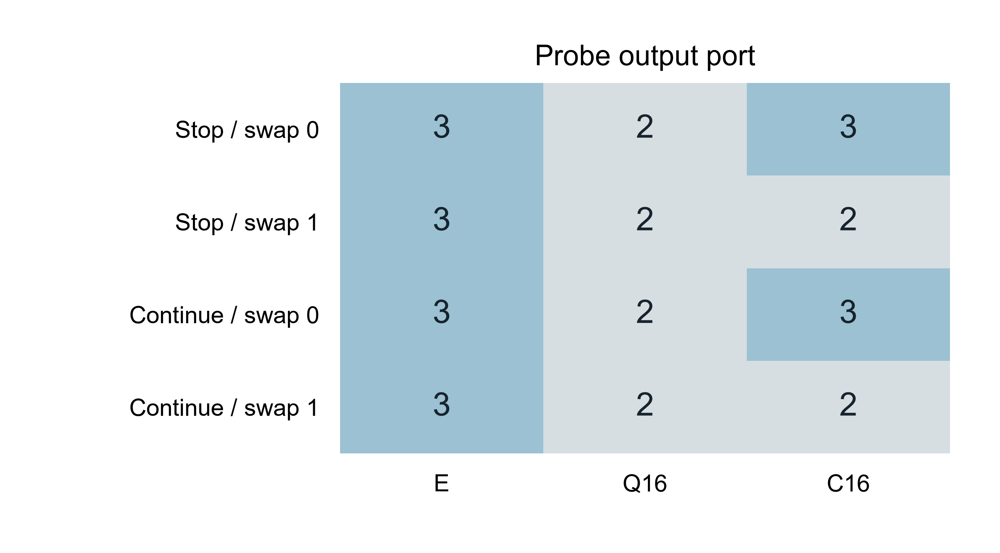
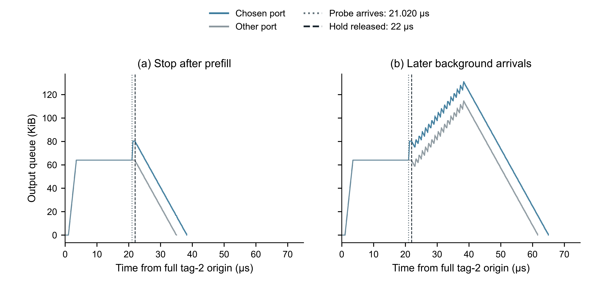

# WS-30 面向 v12 的跨阶段证据综合包

记录日期：2026 年 10 月 25 日。本包供主对话整合中文 v12 正文，覆盖阶段 1/2、主矩阵 192 格、先占 72 格、组成 12 格，以及 WS-28 第一课题的原生比较、A/B 和批尾诊断。实际分析上下文已核实为 GPT-6.1 Sol / Medium。

新增归因对照支持把本地队列信息用于 QP 首包分配：同候选、同出口固定条件下，Q16 相对随机二选一的 R16 缩短批次。统一候选键与评分的 Q12 也改善批次。撤去所选出口固定的 U16 则使批次和背景 P99 同时变慢，并伴随实际换口和恢复代价。类别额外权重在定向组成中确实改变首包决策，但同步、背景提前 20 μs 与组成数据没有识别出它的稳定时间增量。以上结论各有不同的受控对比与适用范围。

## 1. 流程、统计与交付范围

本次只分析既有本地数据，没有启动新远端实验。对 1,050 个成功 ID 重新核对了 FCT、输入和拓扑哈希；对主矩阵与先占的 264 格，另从 4,376,064 条原始流重建身份、字节、类别原点、FCT、分位数和批尾身份。1050 个 ID 包含历史 456 格、WS-30 的 438 个独立成功实验、WS-28 的 12 格批尾诊断及既有负载曲线的 144 个补充格。共享角色按 ID 去重，不能把它们都当效果重复。

WS-30 的 438 个成功 ID 为阶段 2 的 148 个、组成技术验收 14 个及正式主矩阵/先占/组成 276 个。阶段 2 的 32+24+96 格包含 4 个桥接预检重用。相对最初预算，组成另增加了已获准的 14 格正确性验收；不将这些技术格计入需求效果。另列 6 个保留失败 ID 和 1 个未运行构建，失败流子集均未进入效果估计。运行器曾安全暂停和降载恢复，成功 ID 未重跑；主矩阵未知进程原快照缺少完整归属字段，先占快照虽有 UID/PPID 等信息，进一步归属仍未明。相关原始收据见[实验资源索引](evidence/ws30-v12-r1/D4-experiments.json)及各节点报告。

效果定义为每个需求内 `100×(候选/参照−1)`，再跨需求取中位数。四组各有 24 个独立需求，分别汇总；同一新需求的同步和先占是相关条件，组成是四种固定控制条件。所有图表的点、分母、单位与原始 ID 见[逐点 CSV](evidence/ws30-v12-r1/figure-points.csv)。名义 95% 区间采用需求层有放回重采样 10,000 次，统一固定随机种子 20263003、按需求 seed 排序和相同索引矩阵；重复出现的同一对照现在使用同一区间。历史端点保留在 `archived_ci_*` 列与旧文件中，未修改历史判据。未添加显著性标签或等效性结论。

## 2. D1 与 F1：独立输入组及回归桥接

四组需求 seed 分别为 20262521～20262544、20262721～20262744、20262921～20262944 和 20263021～20263044。同步 192 背景档均含 16,384 条 8 KiB MoE QP 与 192 条 8 MiB 背景 QP，总载荷 1,744,830,464 B。相同需求生成规则、拓扑和公共传输契约没有使四组变成同一输入；端点、碰撞与批尾不同。旧组与历史主组的生成器文件哈希为 `00c5e525…`，A/B 组与新组为 `0739571b…`：后者只增加选择输出背景档位的参数和合法性检查，随机调用与需求构建逻辑不变；完整源文件差异已按此核对。文件逐字节相同与需求规则相同分别记录。完整源码 SHA、原点、输入及判据见[D1 表](evidence/ws30-v12-r1/D1-cohorts.csv)。

旧组 SHA 为 `ce699df`，历史主组为 `ee236f2`，A/B 组为 `955d26b`，新归因组为 `1ef4247`。四组同步 192 档共同采用 400 Gbps、DCQCN、PFC=0、IRN=1、9 MiB 缓冲和 ns-3 seed 1；需求生成 seed 才是独立重复单位。显式 trace 决定实际提供需求，运行参数 `netload=10` 不能写成实测负载为 10%。阶段 1 已核对生成器、ClassReserve/ECMP/DRILL 的相关函数和公共配置；阶段 2 的 96 格在新 SHA 下分别重放旧组与历史主组的 E/C16，完整 FCT 哈希全部对应历史值。该结果排除了这 96 个固定输入上可见的输出变化，不证明所有未测输入或其他原生方法的二进制等价。

旧组的联合门槛是两侧中位至少下降 5%、各有至少 17/24 输入改善，其原 NO-GO 保留。后续 +3% 为背景配对 P99 变化中位数的工程线；它不是逐输入保证、生产 SLO 或统计非劣效。

| 独立组 | MoE 批次变化［名义 95% 区间］ | 批次下降输入 | 背景 P99 变化［区间］ | 背景 >+3% |
| --- | --- | --- | --- | --- |
| 旧组 | -3.536% [-6.463, -1.552] | 20/24 | -0.065% [-2.447, +0.947] | 4/24 |
| 历史主组 | -6.899% [-10.192, -5.147] | 21/24 | +0.552% [-1.504, +2.008] | 6/24 |
| 独立 A/B 组 | -5.211% [-6.939, -2.387] | 21/24 | -0.181% [-1.624, +1.490] | 4/24 |
| 新归因组 | -5.461% [-7.701, -3.152] | 21/24 | -0.123% [-1.497, +2.386] | 7/24 |

F1 图注：每组每面板 24 个完整输入点；菱形为组内配对中位数，横线为需求层名义 95% bootstrap 区间。两面板分别为 MoE 批时间和背景 P99；负值表示时间下降。四组从不合池，虚线为历史工程参考 +3%，不能将旧组按新线改判。点源为 `figure-points.csv` 的 F1；绝对 ECMP 基准和六方法结果另见 D2。

## 3. F2/F3：框架归因、严格类别无关臂与逐输入风险

E 为 ECMP。H16 固定历史首候选，不读队列；R16 用独立哈希硬币在相同两个候选中选择。Q16 对两类读总队列，但保留历史的 MoE 16 字节/背景 12 字节键；C16 为完整 A1B1；M16 为 A0B0，背景只取首候选。Q12 将两类候选键统一为 12 字节并统一总队列评分。U16 保存 Q16 相同的首次候选对，但每包重新比较所选出口，仍有候选状态。

| 臂 / E | MoE 批次变化［区间］ | 下降输入 | 背景 P99 变化［区间］ | 背景 >+3% |
| --- | --- | --- | --- | --- |
| E | +0.000% [+0.000, +0.000] | 0/24 | +0.000% [+0.000, +0.000] | 0/24 |
| H16 | -0.448% [-1.771, +1.214] | 13/24 | +1.835% [+0.427, +2.516] | 7/24 |
| R16 | +0.518% [-1.714, +4.403] | 10/24 | +1.634% [-0.121, +3.213] | 8/24 |
| Q16 | -4.242% [-6.956, -2.618] | 22/24 | +0.089% [-2.144, +1.636] | 5/24 |
| C16 | -5.461% [-7.701, -3.152] | 21/24 | -0.123% [-1.497, +2.386] | 7/24 |
| U16 | +6.950% [+3.099, +11.268] | 5/24 | +9.061% [+6.573, +10.562] | 22/24 |
| Q12 | -4.869% [-6.760, -1.453] | 19/24 | +0.965% [-1.613, +2.021] | 6/24 |
| M16 | -5.210% [-5.761, -4.020] | 22/24 | +1.614% [+0.000, +3.741] | 10/24 |

F2 图注：新组 24 个需求，每臂均与同需求 E 配对，所有点保留；菱形和横线定义同 F1。两面板各有 8×24 个点，包含 E 的零变化参考。背景 +3% 虚线只用于该预设中位工程约束；逐输入越线数见表和[完整风险清单](evidence/ws30-v12-r1/per-input-risk-summary.csv)。不能因 C16 的中位变化接近零忽略其 7/24 输入越线。

F3 图注：九个事前冻结对照，各面板每行 24 个完整需求点，共 9×24 个点。对照右侧为分母，横轴为配对变化百分比。保留正、负和零值，菱形为中位数，横线为名义 95% 需求层区间，无多重比较显著性标记。U16/Q16 只改变出口重决策粒度并保留候选对；Q16/M16 是背景自身选路规则 B 的开关，不命名为一般类别信息效应。

| 对照 | MoE 批次变化［区间］ | 背景 P99 变化［区间］ |
| --- | --- | --- |
| H16/E | -0.448% [-1.771, +1.214] | +1.835% [+0.427, +2.516] |
| R16/H16 | +1.281% [-1.722, +3.025] | +0.149% [-1.362, +2.772] |
| Q16/R16 | -4.555% [-9.519, -2.913] | -1.964% [-4.341, -0.209] |
| Q16/H16 | -5.371% [-6.589, -3.580] | -1.197% [-3.610, +1.122] |
| U16/Q16 | +11.606% [+7.269, +16.615] | +8.447% [+6.690, +11.945] |
| Q12/E | -4.869% [-6.760, -1.453] | +0.965% [-1.613, +2.021] |
| Q16/Q12 | +0.007% [-2.500, +2.415] | -1.779% [-2.991, +0.000] |
| C16/Q16 | +0.058% [-1.561, +0.499] | +0.059% [-0.891, +2.759] |
| Q16/M16 | -0.376% [-1.847, +1.690] | -1.966% [-3.022, -0.012] |

Q16/R16 和 Q16/H16 在该新组中提供了队列信息相对不读队列选择的增量证据。Q12/E 表明观察不限于历史类别键。H16/E 本身也改变了部分输入的两侧结果，故完整方案相对 E 的全部变化不能只归给队列权重。九项估计不能相加成可加的收益份额。

U16 相对 Q16 的两侧时间均增加。正式观测累计记录 658,638 个发生出口变化的（交换机，QP）记录、3,614,093 次换口、471,101 个实际重传包和 225,961 次接收序号 gap；这些不是同一种计数单位。其余七臂相应换口、重传和 gap 计数为零。U16 是独立策略对照，不是原生 DRILL，也不能用来证明缓存容量、硬件开销或恢复机制的唯一中介贡献。

## 4. A/B、F4 与 F5：类别规则和时序条件

旧 A/B 数据来自另一组 24 个需求。A 控制 MoE 评分额外背景字节，B 控制背景首包是否按两候选总队列改路。A0B0 仍在 MoE 与背景之间采用不同选择规则；A0B1 仅统一评分，历史键差异仍在。Q12 才同时统一候选键与评分。四臂相对同需求 ECMP 的完整结果如下，240 个逐输入双侧点和 ID 见[factorial-arm-points.csv](evidence/ws30-v12-r1/factorial-arm-points.csv)。

| 旧 A/B 臂 / E | MoE 中位［区间］ | 批次下降输入 | 背景 P99 中位［区间］ | 背景 >+3% |
| --- | --- | --- | --- | --- |
| A0B0 | -4.451% [-7.458, -2.422] | 22/24 | +0.398% [-1.313, +2.412] | 5/24 |
| A1B0 | -5.233% [-7.256, -2.968] | 23/24 | -1.175% [-2.544, +1.042] | 4/24 |
| A0B1 | -5.971% [-7.556, -1.939] | 20/24 | +0.568% [-0.565, +2.083] | 6/24 |
| A1B1 | -5.211% [-6.939, -2.387] | 21/24 | -0.181% [-1.624, +1.490] | 4/24 |

| 旧 A/B 条件对比 | 单位 | MoE 中位［区间］ | 背景 P99 中位［区间］ |
| --- | --- | --- | --- |
| A_by_B_interaction | 百分点 | +0.732 [-0.342, +1.321] | -0.692 [-2.646, +0.781] |
| A_when_B0 | % | -0.145 [-0.583, +0.352] | -0.940 [-2.840, +0.209] |
| A_when_B1 | % | +0.501 [-1.008, +0.797] | -2.124 [-3.167, +0.147] |
| B_when_A0 | % | -0.252 [-1.200, +1.435] | +1.189 [-1.127, +1.897] |
| B_when_A1 | % | +0.752 [-0.887, +2.696] | +0.222 [-0.798, +1.418] |
| A_by_B_log_interaction | 100×对数比差 | +0.731 [-0.338, +1.308] | -0.735 [-2.628, +0.778] |

旧百分比交互是逐输入两个条件百分比效应的差，单位为百分点；对数交互另按 `100×ln[(A1B1/A0B1)/(A1B0/A0B0)]` 计算。两者分别命名，不相互冒充。所有旧组件区间跨零不证明零效应或等效性；新组 Q16/M16 的背景增量也不能外推成跨组统一的 B 收益。

F4 图注：相同 24 个新需求分别处于同步和背景提前 20 μs 两个相关条件。每面板六行、每行 24 个配对点；灰色为同步、蓝色为先占。MoE 的批次原点分别为 2.000000 s 和 2.000020 s，背景保持逐 QP 起点。菱形和区间定义同 F1。不能将两种条件当作 48 个独立需求。

| 对照 | 条件 | MoE 批次变化［区间］ | 背景 P99 变化［区间］ |
| --- | --- | --- | --- |
| Q16/E | 同步 | -4.242% [-6.956, -2.618] | +0.089% [-2.144, +1.636] |
| Q16/E | 背景提前 20 μs | -5.648% [-7.828, -5.123] | -0.044% [-0.763, +1.505] |
| C16/E | 同步 | -5.461% [-7.701, -3.152] | -0.123% [-1.497, +2.386] |
| C16/E | 背景提前 20 μs | -5.970% [-9.021, -3.872] | +0.014% [-1.105, +1.949] |
| C16/Q16 | 同步 | +0.058% [-1.561, +0.499] | +0.059% [-0.891, +2.759] |
| C16/Q16 | 背景提前 20 μs | +0.020% [-0.740, +0.492] | +0.012% [-1.394, +1.196] |

C16/Q16 在两种条件下均未识别清晰时间增量；先占相对同步的同需求对数比交互也跨零，逐点和区间另见[timing 文件](evidence/ws30-v12-r1/timing-interaction-estimates.json)。在 C16 的逐交换机新 QP、不同候选比较事件中，含背景的比例从 32.392% 降至 25.970%，两种评分选择不一致的比例从 4.727% 降至 3.851%。提前 20 μs 没有增加这两个观测比例；不能事后把“先占必然提高类别信号”写成已知原因。

组成使用独立的 8 节点受控拓扑，主机接入为 400 Gbps，两个候选出口为 40 Gbps，与 1280 主机主矩阵分别解释。实验调度器同时暂停两个出口以建立真实积压；公共传输仍为 PFC=0、IRN=1。

F5 首包图注：每个单元为一个正式组成格的实际探针出口。两候选均为 65,536 B 真实积压，方向 0 的背景字节为端口 2/3 上 65,536/0 B，方向 1 相反。E 始终选 3，Q16 平局保留首候选 2，C16 随组成选 3/2；每个探针的 16 个包保持该出口。四种控制条件各一次仿真，不画抽样区间。

F5 队列图注：每面板叠加 6 个正式格×2 个真实出口的完整队列轨迹，共 12 条曲线；按实际探针选择归一为所选/另一出口，不作跨运行均值。保留全部 6,528 个队列事件，重叠曲线完整保存在[F5 原始点表](evidence/ws30-v12-r1/F5-queue-events.csv)。横轴从完整标签 2 批次原点 2.000000 s 起算，单位 μs；纵轴为 KiB。探针到达与暂停释放分别在 21.020 μs、22 μs。

最后预填在 2,000,003,500 ns 入队；探针整列在 2,000,021,320 ns 入队完毕，暂停解除前没有出队。后续背景首包在 2,000,023,019 ns 入队。完整标签 2 包括两个预填 QP 与探针，12 格批时间均为 45.665 μs，探针自身 FCT 均为 25.665 μs；同条件三臂背景 P99 相同。持续背景的方向 0 C16/Q16、方向 1 C16/E 各有 16 条背景 QP 变快、16 条变慢、2 条不变，最不利增加 3.345 μs（16.916%）。这说明规则响应和局部代价可以被观察到，却没有在该夹具转化为批时间或 P99 改善。完整 252 条 FCT、逐流差和四种条件数值见[组成报告](ws30-stage3-composition-node-report-r1.md)。

## 5. D2/D3：原生比较、实现前提和路径覆盖

| 组 | 方法 | MoE 相对 ECMP［区间］ | 背景 P99 相对 ECMP［区间］ | 背景 >+3% |
| --- | --- | --- | --- | --- |
| 旧组 | fecmp | +0.000% [+0.000, +0.000] | +0.000% [+0.000, +0.000] | 0/24 |
| 旧组 | drill | -13.637% [-15.593, -11.609] | +4.620% [+3.331, +8.686] | 19/24 |
| 旧组 | conga | +4.546% [+1.257, +7.121] | -0.358% [-2.513, +1.130] | 5/24 |
| 旧组 | letflow | +0.502% [-1.863, +4.215] | -0.147% [-1.451, +0.952] | 4/24 |
| 旧组 | conweave | +0.799% [-2.100, +3.355] | -0.397% [-2.486, +0.989] | 6/24 |
| 旧组 | classreserve | -3.536% [-6.463, -1.552] | -0.065% [-2.447, +0.947] | 4/24 |
| 历史主组 | fecmp | +0.000% [+0.000, +0.000] | +0.000% [+0.000, +0.000] | 0/24 |
| 历史主组 | drill | -15.847% [-18.157, -14.629] | +8.388% [+4.191, +10.592] | 20/24 |
| 历史主组 | conga | +3.377% [-0.294, +6.843] | +0.199% [-0.898, +2.969] | 7/24 |
| 历史主组 | letflow | -1.239% [-3.118, +3.284] | +0.456% [-1.446, +2.132] | 6/24 |
| 历史主组 | conweave | -0.567% [-2.896, +2.413] | -0.669% [-2.136, +0.597] | 3/24 |
| 历史主组 | classreserve | -6.899% [-10.192, -5.147] | +0.552% [-1.504, +2.008] | 6/24 |

绝对 ECMP 批时间中位数为旧组 18.022 μs、历史主组 18.540 μs，背景 P99 分别为 1,680.833 μs、1,614.923 μs。所有方法的绝对值和区间在[D2 CSV](evidence/ws30-v12-r1/D2-native-baselines.csv)中，288 个逐输入值有 raw/ID 锚点。两组均是 DRILL 的批时间最短、ClassReserve 次之；原先“整体排序反转”来自比较分母误读，效应幅度差异本身仍保留。

CONGA、LetFlow 两组 flowlet timeout 均为 0。ConWeave 旧组 RTT 回复/通知/换路累计为 11,884,225/12,574/1，历史主组为 11,833,940/12,894/0；旧组 1 格发生换路和 VOQ 动作，主组没有。零换路不能写成整个方法没有运行，也不等价 ECMP 的逐包路径。该原生表只描述公共配置中的实测结果；未运行激活动态机制的新负载，不保留对完整动态能力的一般优越性结论。

DRILL 在两组批时间改善更大，背景 P99 中位增加 +4.620%/+8.388%，属于双侧权衡。本次另检查了[48 份原生 DRILL 日志](evidence/ws30-v12-r1/native-drill-observation-audit.json)，均没有独立逐 QP 恢复观测行；其重传/gap 字段留缺失，不能以 CNP、零或 U16 的计数替代。DRILL 引用已核验为 SIGCOMM 2017，DOI `10.1145/3098822.3098839`，作者版 PDF 的阅读范围是引用与逐包局部队列比较，尚未完成候选库逐页精读。

当前类别标签来自 trace 第六列，经 QP 保存为 ns-3 PacketTag；未验证线上 DSCP/BTH 分类协议。Q_bg 是共享出口队列的逐包类别字节记账，不表示分类物理队列。缓存用源/目的 IP 与 UDP 源/目的端口的精确键和 `std::map`，没有固定硬件容量、老化或淘汰策略；当前输入使用唯一生成的传输元组。正文只能据此说明软件实现与部署前提，不能声称已验证线速、ASIC 占用或长期元组复用。

22 个技术全日志格已按拓扑重建每个被接受数据包从首跳至末跳的路径，固定臂未出现端到端路径变化，U16 的变化分支已覆盖，H12 与 E 的路径签名和 FCT 相同。正式主矩阵与先占使用逐交换机 QP 汇总，不能称为全部正式包的完整路径重放。稳定静态拓扑内每跳固定与技术实测共同支持路径保持；它不构成任意故障或真实 RNIC 的保序保证。详细语义与缺失项见[D3](evidence/ws30-v12-r1/D3-new-arm-actions.csv)和[实现契约](evidence/ws30-v12-r1/implementation-contract.json)。

## 6. WS-28 第一课题及背景尾部风险

WS-28 的三个已揭盲劣化输入均发生批尾 QP 身份切换。ClassReserve 新批尾最高序号目标包的最长单跳等待分别为 seed 20262725 的 6,179 ns、20262729 的 6,905 ns、20262739 的 6,571 ns；入队前背景字节分别为 97,464、167,680、99,560 B。对应 12 个探针开关格的 FCT 与原格一致。首包评分、下游末包等待和整批变化属于不同对象与时刻；这里没有未走路径的反事实或完整发送速率轨迹，不能将局部等待直接当作整批劣化，更不能唯一归因于 A/B。完整逐跳点、ID 和原图入口见[WS-28 分析](ws28-factorial-and-tail-analysis.md)。

第一课题的两种 P95 必须分开：每输入内 16,384 条 MoE 单流 P95 的配对变化中位数为 −1.012%；24 个输入级批时间的跨输入 P95 变化为 −6.888%。它们均不替代 −6.899% 的原主指标。本包对新组另交付单流 P50/P95/P99、背景 P95/P99/最大值、跨需求批时间 P95 和全部批尾身份，见[补充指标 CSV](evidence/ws30-v12-r1/secondary-metrics.csv)。

64 背景档的 −50.123% P99 离群点为 seed 20262744，ECMP/C16 的 P99 为 1044.10412/520.77116 μs，P95 为 785.09080/517.12645 μs；两臂全部 64 条背景 FCT 均保留。P99 是第 63、64 个排序值的 0.63/0.37 加权，不能叫最大值。该单输入结果保留在图点和[128 行尾部数据](evidence/ws30-v12-r1/load64-outlier-background-flows.csv)中；仅凭 FCT 排序不能指定唯一网络原因。

## 7. v12 主张、评审验收与剩余项

正文可围绕三个有对应对照的发现组织：首包队列信息的增量、QP 重决策粒度的双侧代价、类别规则的条件检验。四组整体结果是输入相关的支持证据，类别加权在规则层可触发、在业务时间层未识别稳定增量。逐输入风险与原生执行状态应与中位数一起出现。可写入、需收缩与不可外推的逐条主张见[claims.json](evidence/ws30-v12-r1/claims.json)。

三份 review 的各编号项分别保留映射；另纠正 A0B0 类别语义、跨零即无效、零换路即 ECMP、排序分母、P99、负载相关性和计数单位等事实误读。完整状态见[评审验收表](ws30-v12-review-acceptance-r1.md)。证据已经补齐的项与尚待正文实现的项分开；动态激活负载、真实 trace、硬件、权重扫描等未运行项保持明确状态。

本 WS 的已冻结实验与 F1～F5、D1～D4 数据交付均有对应入口。主对话仍须完成中文 v12 的标题、摘要、机制、图注、引用、结论与全文一致性审校，并验收本包；本分支保持 WS-30 ACTIVE，不按全文闭环归档。当前没有发现需要补跑远端仿真的预设技术缺格。

## 8. 图表、原始身份与参考复核入口

- [数据包清单](evidence/ws30-v12-r1/package.json)：各统计单位、CI 算法、原始文件输入哈希。
- [全部 ID 与资源](evidence/ws30-v12-r1/D4-experiments.json)：成功角色去重、失败和未运行构建、raw 路径与 SHA-256。
- [图源](../../scripts/plot_ws30_v12_package.py)、[数据构建](../../scripts/build_ws30_v12_package.py)：没有仿真启动入口。
- [图表契约与 QA](figures/ws30-v12-r1/qa.json)：逐面板完整点、对齐、碰撞、字体和最终尺寸检查。
- [参考借鉴复核](evidence/ws30-v12-r1/reference-review.json)：固定论文版本、PDF/技术分析/核验记录哈希、适用条件和不能外推的结论。

本重要节点从候选 README 与 reading-log 进入，复核了 DiffFlow、SeqBalance、LetFlow、ConWeave、Gemma、SGLB、HULA，以及 DRILL 的引用与机制记录。借鉴点分别为类别与粒度分离、最大完成聚合、适应机会、动态分支忠实性、下游信息与重排成本、全局反馈和状态规模、逐跳探测，以及逐包局部队列比较。它们没有构成本项目收益证据或新机制准入。候选技术附件中的“本项目”是撰写时的历史语境，当前机制差异以本次固定源码的首包 QP 路由为准。
